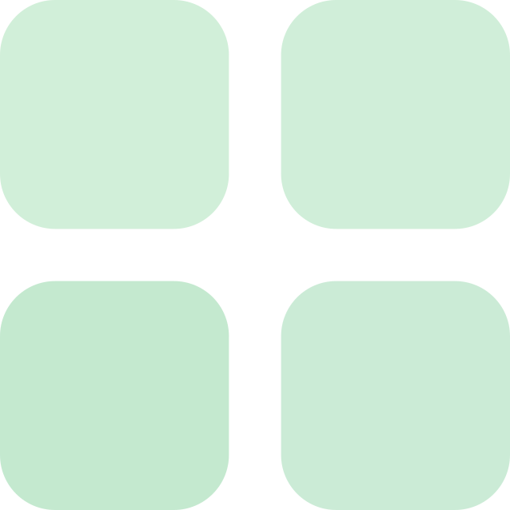

  <picture>
    <source media="(prefers-color-scheme: dark)" srcset="website/public/logo-dark.svg">
    
  </picture>
  <h1>cleanup</h1>
  
A little less clutter. A lot more room.

  
A native Windows 11 app for removing applications and organizing folders.

  

    <a href="https://cleanup-wiredin.vercel.app">Website</a> ·
    <a href="https://github.com/wiredincorp/cleanup/releases">Releases</a> ·
    <a href="https://discord.gg/5kRtCcNWU6">Discord</a>
  

## A place for everything

- **See your space.** View used and free storage across your drives.
- **Let apps go.** Find applications, review your selection, and run their official uninstallers. Review leftovers separately.
- **Sort the pile.** Preview folder organization, choose what moves, and save rules for next time.
- **Keep a clear history.** Review results and undo eligible file moves.

Made with WinUI 3 and Rust, with light and dark themes that feel at home on Windows.

## Download for Windows

**[Download Cleanup.exe](https://github.com/wiredincorp/cleanup/releases/download/v0.1.3-rc.1/Cleanup.exe)** and double-click it. It runs as a standard user and includes its runtime. On first launch, Windows support files are extracted to a temporary folder.

For a Start menu shortcut and an uninstaller, use the [setup EXE](https://github.com/wiredincorp/cleanup/releases/download/v0.1.3-rc.1/cleanup-0.1.3-windows-x64-setup.exe). Some applications' official uninstallers may ask Windows for approval.

Windows 11 x64. For USB portability, keep `Cleanup.exe` and its `CleanupData` folder together to carry settings and history between PCs. If that location is read-only, Cleanup uses your Windows profile instead. This unsigned preview may show an unknown-publisher warning.

To update, use Settings > Check for updates, then replace `Cleanup.exe` and keep `CleanupData` beside it. ARM64 emulation is unverified; macOS/Linux builds are unavailable.

Open-source source and developer build notes are in the [development guide](docs/development.md).

## Around the project

[Contributing](CONTRIBUTING.md) · [Launch and updates](docs/launch.md) · [Security](SECURITY.md)

Licensed under [MIT](LICENSE). [Third-party notices](THIRD_PARTY_NOTICES.md).

©(wired-in) community
